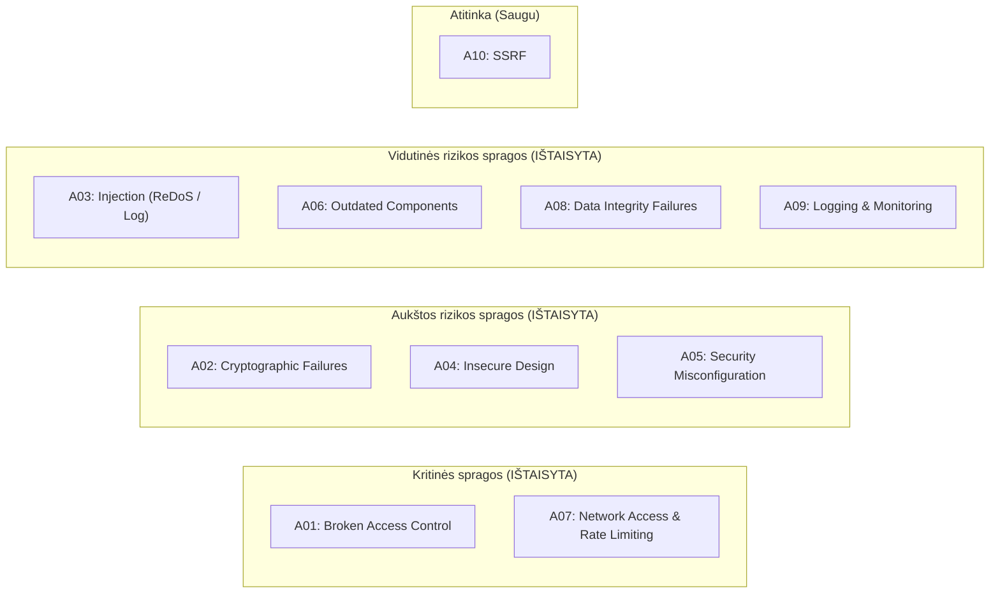

# Projekto „prabhupada.lt“ saugos audito ataskaita (OWASP Top 10)

Šiame dokumente pateikiamas viso projekto (`server/`, `admin/`, `client/` ir Nginx konfigūracijų `docs/`) informacijos saugos vertinimas pagal **OWASP Top 10 (2021)** standartą, identifikuotos saugos spragos bei atlikti techniniai pataisymai.

---

## Aukšto lygio santrauka

| OWASP kategorija | Pradinė rizika | Būsena po pataisymų | Atlikti veiksmai |
| :--- | :--- | :--- | :--- |
| **A01:2021 – Broken Access Control** | 🔴 **KRITINĖ** | ✅ **IŠTAISYTA** | Administraciniai maršrutai apsaugoti dviguba gynyba: Nginx (`prabhupada.lt.conf` ir `prabhupada.admin.conf`) bei Express [`requireLocalNetwork`](file:///Users/satakula/Repos/prabhupada/server/securityMiddleware.js#L52-L63); pašalintas masinio trynimo maršrutas `/api/delete`; nepublikuoti įrašai apsaugoti nuo išorinio atsisiuntimo/grojimo. |
| **A02:2021 – Cryptographic Failures** | 🟠 **AUKŠTA** | ✅ **IŠTAISYTA** | Pridėtas PostgreSQL SSL palaikymas (`POSTGRES_SSL`); pašalintas `http://prabhupada.lt` iš CORS; sugriežtintos `.env` failo teisių rekomendacijos (`chmod 600`). |
| **A03:2021 – Injection** | 🟡 **VIDUTINĖ** | ✅ **IŠTAISYTA** | Ištaisytas **ReDoS** pažeidžiamumas faile [parser.js](file:///Users/satakula/Repos/prabhupada/server/parser.js#L25); pridėtas žurnalų įrašų valymas (`sanitizeLog`) nuo **Log Injection**. |
| **A04:2021 – Insecure Design** | 🟠 **AUKŠTA** | ✅ **IŠTAISYTA** | `/api/import` pakeistas iš `GET` į `POST`; pašalintas `naikintiViska` funkcionalumas; uždraustas esamų MP3 failų perrašymas diske per [upload.js](file:///Users/satakula/Repos/prabhupada/server/upload.js#L54-L59). |
| **A05:2021 – Security Misconfiguration** | 🟠 **AUKŠTA** | ✅ **IŠTAISYTA** | Paslėpti `err.stack` ir vidiniai PostgreSQL klaidų objektai; ištaisytas `200 OK` statuso grąžinimas klaidų metu; pridėtos saugumo HTTP antraštės tiek Express ([securityMiddleware.js](file:///Users/satakula/Repos/prabhupada/server/securityMiddleware.js#L41-L48)), tiek Nginx konfigūracijose. |
| **A06:2021 – Vulnerable Components** | 🟡 **VIDUTINĖ** | ✅ **IŠTAISYTA** | [DEPLOY.md](file:///Users/satakula/Repos/prabhupada/server/DEPLOY.md#L14-L19) atnaujintas iš pasenusio Node.js 18 į Node.js 22 LTS. |
| **A07:2021 – Identification & Auth Failures** | 🔴 **KRITINĖ** | ✅ **IŠTAISYTA** | Pagal pasirinktą architektūrą (Variantas B) administravimas apribotas vietiniam tinklui abiejuose sluoksniuose (Nginx + Express) ir įdiegtas užklausų dažnio ribojimas ([`createRateLimiter`](file:///Users/satakula/Repos/prabhupada/server/securityMiddleware.js#L68-L108)). |
| **A08:2021 – Software & Data Integrity** | 🟡 **VIDUTINĖ** | ✅ **IŠTAISYTA** | Pridėtas tikrųjų MP3 failo antraštės baitų („magic bytes“ `ID3` / `0xFF 0xE0`) tikrinimas ([`isValidMp3File`](file:///Users/satakula/Repos/prabhupada/server/controller.js#L31-L55)) bei griežta UUID ir įvesties laukų validacija. |
| **A09:2021 – Logging & Monitoring** | 🟡 **VIDUTINĖ** | ✅ **IŠTAISYTA** | Įjungtas `app.set('trust proxy', 'loopback')` apsaugai nuo `X-Forwarded-For` klastojimo; į `logs` lentelę rašoma tik pradedant groti įrašą (`start === 0`); pridėtas IP adresų fiksavimas administraciniams veiksmams. |
| **A10:2021 – SSRF** | 🟢 **SAUGU** | ✅ **ATITINKA** | Serveris nevykdo išeinančių tinklo užklausų pagal vartotojo pateiktus URL. |

---

## Nginx konfigūracijų (`docs/`) auditas ir pataisymai

Patikrinus [docs/prabhupada.lt.conf](file:///Users/satakula/Repos/prabhupada/docs/prabhupada.lt.conf) ir [docs/prabhupada.admin.conf](file:///Users/satakula/Repos/prabhupada/docs/prabhupada.admin.conf) rastos ir ištaisytos šios kritinės problemos:

1. **Atvira prieiga prie `prabhupada.admin` per `Host` antraštės klastojimą ([docs/prabhupada.admin.conf](file:///Users/satakula/Repos/prabhupada/docs/prabhupada.admin.conf))**:
   - **Problema:** `prabhupada.admin.conf` faile nebuvo `allow` / `deny` taisyklių. Nors domenas `prabhupada.admin` viešame DNS neegzistuoja, bet kuris išorinis puolėjas galėjo nusiųsti užklausą į serverio viešą IP adresą su HTTP antrašte `Host: prabhupada.admin` (pvz., `curl -H "Host: prabhupada.admin" http://<serverio_ip>/api/delete -X DELETE`). Nginx tokią užklausą nukreipdavo į `prabhupada.admin` virtualų serverį, kuriame jokie `/api/*` apribojimai negaliojo!
   - **Pataisymas:** Į [docs/prabhupada.admin.conf](file:///Users/satakula/Repos/prabhupada/docs/prabhupada.admin.conf#L17-L19) `server` bloką pridėta `allow 127.0.0.1; allow 192.168.0.0/16; deny all;`.
2. **Aiškus atsakomybių atskyrimas be dubliavimo ([docs/prabhupada.lt.conf](file:///Users/satakula/Repos/prabhupada/docs/prabhupada.lt.conf))**:
   - **Problema:** Viešame `prabhupada.lt.conf` faile rankiniu būdu buvo išvardinta dalis administracinių `location /api/...` blokų (praleidžiant `/api/get` ir `X-Forwarded-For` antraštes), o `client_max_body_size 500M` galiojo visam viešam serveriui.
   - **Pataisymas:** Viešam puslapiui nustatytas `client_max_body_size 1M;`, pašalintas besidubliuojantis `/api/*` maršrutų sąrašas iš `prabhupada.lt.conf` (paliktas vienas `location /api` blokas su `X-Real-IP` ir `X-Forwarded-For`), o administracinių maršrutų IP tikrinimas centralizuotas vienoje vietoje – Node.js faile [routes.js](file:///Users/satakula/Repos/prabhupada/server/routes.js#L16-L24) per [`requireLocalNetwork`](file:///Users/satakula/Repos/prabhupada/server/securityMiddleware.js#L50-L61). Taip pat bendrosios saugumo HTTP antraštės (`X-Frame-Options`, `X-Content-Type-Options`, `Referrer-Policy`) paliktos tik Nginx lygyje, kad nebūtų dubliuojamos `/api` atsakymuose.

---

## Detali analizė ir atlikti pataisymai pagal OWASP Top 10

### 1. A01:2021 – Broken Access Control (Pažeista prieigos kontrolė)
- **Dviguba prieigos kontrolė (Defense-in-Depth):** Be Nginx IP filtravimo, sukurtas [`requireLocalNetwork`](file:///Users/satakula/Repos/prabhupada/server/securityMiddleware.js#L52-L63) tarpinis sluoksnis, kuris taikomas visiems administraciniams maršrutams faile [routes.js](file:///Users/satakula/Repos/prabhupada/server/routes.js#L16-L24). Net jei užklausa apeitų Nginx, Express patikrina kliento IP ir atmeta išorines užklausas su `403 Forbidden`.
- **Nepublikuotų įrašų apsauga:** Funkcijose [`atsisiusti`](file:///Users/satakula/Repos/prabhupada/server/controller.js#L114-L116) ir [`groti`](file:///Users/satakula/Repos/prabhupada/server/controller.js#L210-L212) pridėtas patikrinimas, kad nepublikuotos paskaitos (`!record.published && record.data !== null`) negalėtų būti grojamos ar atsisiunčiamos iš išorinio tinklo.
- **Saugus failo kelio tikrinimas:** Funkcijoje [`resolveSafePath`](file:///Users/satakula/Repos/prabhupada/server/controller.js#L18-L26) pridėta griežta patikra `resolvedPath.startsWith(audioBasePath + path.sep)`.

### 2. A02:2021 – Cryptographic Failures (Kriptografinės klaidos)
- Faile [queries.js](file:///Users/satakula/Repos/prabhupada/server/queries.js#L11) pridėtas `POSTGRES_SSL=true` palaikymas.
- Iš [server.js](file:///Users/satakula/Repos/prabhupada/server/server.js#L19) CORS sąrašo pašalintas nesaugus `http://prabhupada.lt` adresas (paliktas tik `https://prabhupada.lt`).

### 3. A03:2021 – Injection (Injekcijos)
- **ReDoS apsauga:** Faile [parser.js](file:///Users/satakula/Repos/prabhupada/server/parser.js#L25) įdėtas kvantorius `(?<knyga>[A-Ža-ž]+[ ]+)+` pakeistas į tiesinio laiko išraišką `(?<knyga>[A-Ža-ž]+(?:[ ]+[A-Ža-ž]+)*)[ ]+` bei apribotas failo pavadinimo ilgis iki 255 simbolių.
- **Log Injection apsauga:** Faile [controller.js](file:///Users/satakula/Repos/prabhupada/server/controller.js#L16) pridėta funkcija [`sanitizeLog`](file:///Users/satakula/Repos/prabhupada/server/controller.js#L16), kuri pašalina `\r` ir `\n` simbolius iš visų į žurnalus rašomų parametrų.

### 4. A04:2021 – Insecure Design (Nesaugus projektavimas)
- **Masinio trynimo pašalinimas:** Pašalintas pavojingas `DELETE /api/delete` (`naikintiViska` / `istrintiVisusIrasus`) maršrutas iš [routes.js](file:///Users/satakula/Repos/prabhupada/server/routes.js), [controller.js](file:///Users/satakula/Repos/prabhupada/server/controller.js), [queries.js](file:///Users/satakula/Repos/prabhupada/server/queries.js) bei mygtukas iš [admin/src/routes/lectures.jsx](file:///Users/satakula/Repos/prabhupada/admin/src/routes/lectures.jsx).
- **Teisingas HTTP metodas importui:** `/api/import` pakeistas iš `GET` į `POST` tiek [server/routes.js](file:///Users/satakula/Repos/prabhupada/server/routes.js#L20), tiek [admin/src/dataService.js](file:///Users/satakula/Repos/prabhupada/admin/src/dataService.js#L42).
- **Failų perrašymo prevencija:** Faile [upload.js](file:///Users/satakula/Repos/prabhupada/server/upload.js#L54-L58) pridėta patikra `fs.existsSync(targetPath)`, neleidžianti įkelti failo ir tyliai perrašyti jau egzistuojančio MP3 įrašo.

### 5. A05:2021 – Security Misconfiguration (Saugumo konfigūracijos klaidos)
- **Klaidų apdorojimas:** Faile [errorMiddleware.js](file:///Users/satakula/Repos/prabhupada/server/errorMiddleware.js#L1-L21) paslėptas `err.stack` produkcijos aplinkoje ir ištaisytas klaidingas `200 OK` HTTP statuso grąžinimas. Faile [controller.js](file:///Users/satakula/Repos/prabhupada/server/controller.js) pašalintas vidinių PostgreSQL klaidų objektų siuntimas klientui.
- **Saugumo HTTP antraštės:** Bendrosios saugumo antraštės (`X-Content-Type-Options: nosniff`, `X-Frame-Options`, `Referrer-Policy`) nustatomos Nginx reverse proxy lygyje ([docs/prabhupada.lt.conf](file:///Users/satakula/Repos/prabhupada/docs/prabhupada.lt.conf#L10-L12), [docs/prabhupada.admin.conf](file:///Users/satakula/Repos/prabhupada/docs/prabhupada.admin.conf#L11-L13)), o Express pusėje ([securityMiddleware.js](file:///Users/satakula/Repos/prabhupada/server/securityMiddleware.js#L43-L46)) pridedama `Cross-Origin-Resource-Policy: cross-origin` bei išjungta `X-Powered-By` antraštė.
- **Minimalios DB privilegijos:** Faile [DEPLOY.md](file:///Users/satakula/Repos/prabhupada/server/DEPLOY.md#L76-L77) `GRANT ALL PRIVILEGES` pakeista į `GRANT SELECT, INSERT, UPDATE, DELETE`.

### 6. A06:2021 – Vulnerable and Outdated Components
- [DEPLOY.md](file:///Users/satakula/Repos/prabhupada/server/DEPLOY.md#L14-L19) atnaujintas į Node.js 22 LTS.

### 7. A07:2021 – Identification and Authentication Failures
- Faile [server.js](file:///Users/satakula/Repos/prabhupada/server/server.js#L23) prijungtas [`createRateLimiter`](file:///Users/satakula/Repos/prabhupada/server/securityMiddleware.js#L68-L108) (600 užklausų per 15 min. vienam IP adresui), apsaugantis API ir DB nuo DoS atakų.

### 8. A08:2021 – Software and Data Integrity Failures
- **MP3 „Magic Bytes“ patikra:** Funkcijoje [`ikelti`](file:///Users/satakula/Repos/prabhupada/server/controller.js#L298-L304) po įkėlimo patikrinami pirmieji failo baitai su [`isValidMp3File`](file:///Users/satakula/Repos/prabhupada/server/controller.js#L31-L55). Jei failas nėra tikras MP3 (`ID3` arba MPEG frame sync `0xFF 0xE0`), jis nedelsiant ištrinamas iš disko (`fs.unlink`).
- **UUID ir įvesties validacija:** Visuose maršrutuose su `:id` parametru pridėta [`isValidUuid`](file:///Users/satakula/Repos/prabhupada/server/controller.js#L14) patikra, o įvesties duomenys griežtai validuojami ir apribojami per [`transformInput`](file:///Users/satakula/Repos/prabhupada/server/controller.js#L69-L86).

### 9. A09:2021 – Security Logging and Monitoring Failures
- Faile [server.js](file:///Users/satakula/Repos/prabhupada/server/server.js#L16) nustatytas `app.set('trust proxy', 'loopback')`, todėl `req.ip` naudoja `X-Forwarded-For` tik tada, kai užklausa ateina iš vietinio Nginx proxy (`127.0.0.1`).
- Funkcijoje [`groti`](file:///Users/satakula/Repos/prabhupada/server/controller.js#L256-L258) įrašas į PostgreSQL `logs` lentelę daromas tik pradedant groti failą (`start === 0` arba kai nėra `Range` antraštės), taip apsaugant duomenų bazę nuo tūkstančių perteklinių įrašų prasukinėjant audio takelį.
